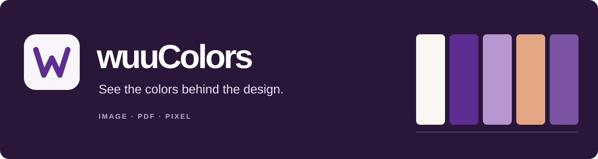
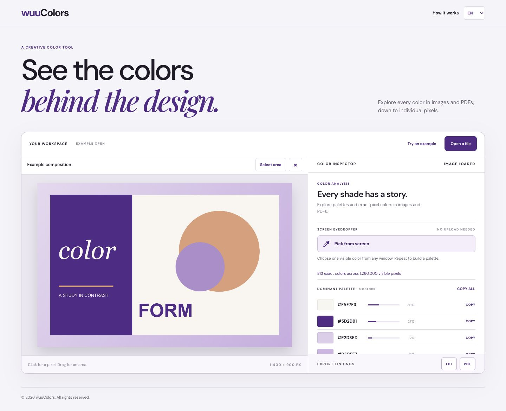
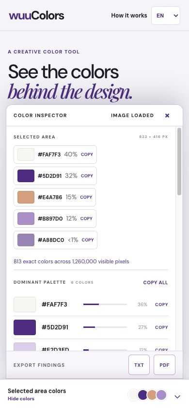

<p align="center">
  
</p>

<p align="center">
  Explore the colors in images and PDFs, from a quick palette to every decoded pixel.
  <br>
  Everything runs in your browser, on your device.
</p>

<p align="center">
  <a href="#preview">Preview</a> ·
  <a href="#features">Features</a> ·
  <a href="#run-locally">Run locally</a>
</p>

## Preview



<p align="center"><sub>Explore a file and see its palette alongside the image.</sub></p>

<p align="center">
  
  &nbsp;
  
</p>

<p align="center"><sub>Select an area on a touchscreen, then open its colors without leaving the image.</sub></p>

## Features

<table>
  <tr>
    <td width="52"></td>
    <td><strong>Open images and PDFs</strong><br>Import PNG, JPEG, WEBP, AVIF, GIF, BMP, SVG, HEIC, HEIF, or PDF files. Processing stays on your device.</td>
  </tr>
  <tr>
    <td></td>
    <td><strong>See the whole color story</strong><br>Browse dominant and accent palettes, inspect a single pixel, or view every exact HEX color with its pixel count.</td>
  </tr>
  <tr>
    <td></td>
    <td><strong>Focus on an area</strong><br>Draw an area with a mouse. On touchscreens, create a box, move it, resize it, and keep the selection visible while exploring its colors.</td>
  </tr>
  <tr>
    <td></td>
    <td><strong>Take the colors with you</strong><br>Copy color values or export a TXT or PDF summary. Download the exact color list as CSV.</td>
  </tr>
</table>

On supported desktop browsers, the screen eyedropper can also pick a color from another visible window. The interface is available in English, French, and Spanish.

## Run locally

The site is static HTML, CSS, and JavaScript. There is no account, backend, or build step. Python 3 is one convenient way to serve the files locally:

```bash
python3 -m http.server 8000 --directory dist
```

Open [http://localhost:8000](http://localhost:8000) and choose **Try an example** to explore the app. Any static file server can serve `dist/`.

## Project layout

| Path | Purpose |
| --- | --- |
| `dist/index.html`, `dist/styles.css` | Interface, metadata, and responsive layout |
| `dist/app.js`, `dist/color-analysis.js` | File handling, pixel analysis, palettes, and exports |
| `dist/selection-geometry.mjs` | Touch selection placement, moving, and resizing |
| `dist/i18n.js` | English, French, and Spanish interface text |
| `dist/pdf.min.mjs`, `dist/pdf.worker.min.mjs` | Local PDF rendering |
| `dist/heic-to.js` | Local HEIC/HEIF fallback decoder |
| `dist/fonts/` | Bundled typefaces and their licenses |
| `docs/` | README artwork and screenshots |

## Browser notes

The screen eyedropper requires browser support and a secure context, so it appears only on compatible desktop browsers. Files are limited to 25 MB. Exact image colors are counted from decoded pixels, even when the preview is scaled. PDF colors are counted from rendered pages, so the render resolution affects the result.

Bundled library and font license notices are included beside their assets in `dist/`.

**Planned domain:** `wuucolors.com`
