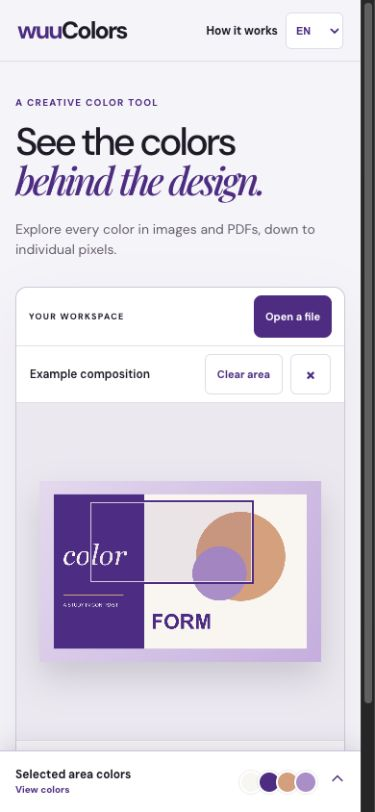

  

  Explore the colors in images and PDFs, from a quick palette to every decoded pixel.
   
  Everything runs in your browser, on your device.

  <strong>Website</strong> · <code>wuucolors.com</code> (planned)
   
  <strong>Built with</strong> · HTML · CSS · JavaScript · Canvas API · PDF.js
   
  <a href="LICENSE">MIT License</a>

## Preview

Explore a file and see its palette alongside the image.

  
  &nbsp;
  

Select an area on a touchscreen, then open its colors without leaving the image.

## Features

<table>
  <tr>
    <td width="52"></td>
    <td><strong>Open images and PDFs</strong> Import PNG, JPEG, WEBP, AVIF, GIF, BMP, SVG, HEIC, HEIF, or PDF files. Processing stays on your device.</td>
  </tr>
  <tr>
    <td></td>
    <td><strong>See the whole color story</strong> Browse dominant and accent palettes, inspect a single pixel, or view every exact HEX color with its pixel count.</td>
  </tr>
  <tr>
    <td></td>
    <td><strong>Focus on an area</strong> Draw an area with a mouse. On touchscreens, create a box, move it, resize it, and keep the selection visible while exploring its colors.</td>
  </tr>
  <tr>
    <td></td>
    <td><strong>Take the colors with you</strong> Copy color values or export a TXT or PDF summary. Download the exact color list as CSV.</td>
  </tr>
</table>

On supported desktop browsers, the screen eyedropper can also pick a color from another visible window. The interface is available in English, French, and Spanish.

## How it works

Your image is decoded, or a PDF page is rendered, in the browser. wuuColors counts the resulting pixels by exact HEX value and groups them into dominant and accent colors. You can then inspect one pixel or a selected area and export the results. Your file stays on your device.
