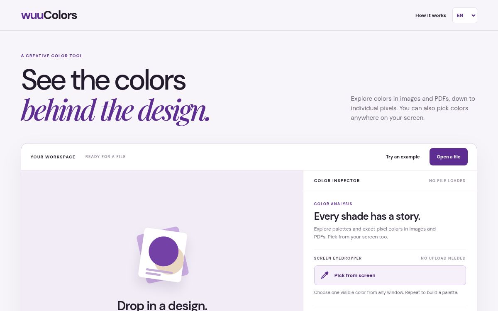

# wuuColors

**See the colors behind the design.**

wuuColors makes it easy to find colors in images and PDFs. Open a file to see its dominant palette, small accent colors, and a count of every visible pixel color. Inspect an exact pixel or select a smaller area to study. A screen eyedropper is available on supported desktop browsers.

**Planned domain:** `wuucolors.com`



## What you can do

- Explore dominant and accent colors in PNG, JPG, HEIC, HEIF, WEBP, AVIF, GIF, BMP, SVG, and PDF files.
- Browse every exact HEX color with its pixel count, or download the complete list as CSV.
- Click a pixel to read its HEX, RGB, and HSL values.
- Select an area to see a focused palette, with the selected region kept visible on the image.
- Pick a color from another visible window with the browser's screen eyedropper on supported desktop browsers. On phones and tablets, import a screenshot instead.
- Copy colors or download a TXT or PDF summary.
- Use the interface in English, French, or Spanish on desktop, tablet, or phone.

Files are analyzed in your browser. The app has no account or server component, and your files are not uploaded.

## Run it locally

You need Python 3 or any static file server. No install or build step is required.

```bash
python3 -m http.server 8000 --directory dist
```

Open `http://localhost:8000` in your browser. Choose **Try an example** to explore the interface without a file.

## Project files

| Path | Purpose |
| --- | --- |
| `dist/index.html` | Interface and page metadata |
| `dist/styles.css` | Responsive design |
| `dist/app.js` | File handling, color analysis, selection, and exports |
| `dist/color-analysis.js` | Full-resolution pixel counting and palette extraction |
| `dist/i18n.js` | English, French, and Spanish text |
| `dist/pdf.min.mjs`, `dist/pdf.worker.min.mjs` | Local PDF rendering |
| `dist/heic-to.js` | Local HEIC/HEIF fallback decoder |
| `dist/fonts/` | Bundled typefaces and their licenses |
| `docs/preview.jpg` | Website preview |

The bundled PDF, HEIC, and font license notices are included beside their assets in `dist/`.

## Browser notes

The screen eyedropper requires browser support and a secure context and appears only on desktop devices. Files are limited to 25 MB. Image pixels are scanned at their decoded size even when the preview is scaled. PDF colors come from the rendered page, so its rendering resolution determines the pixels counted.
